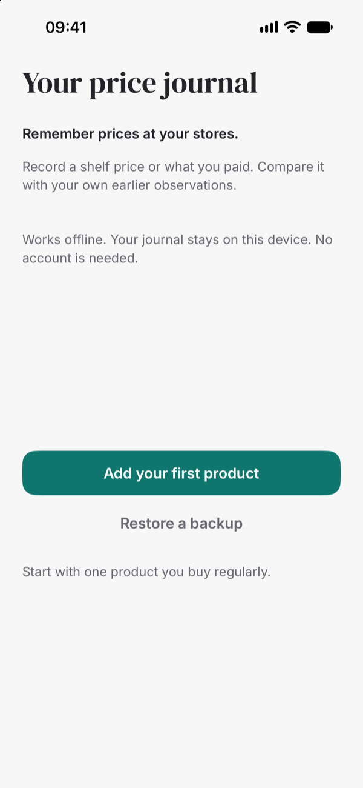
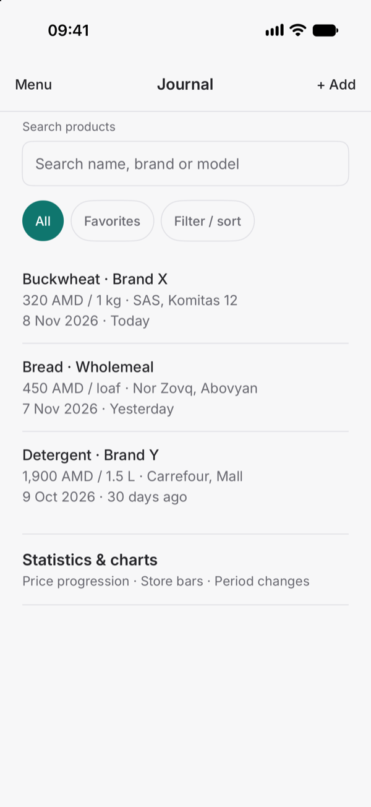
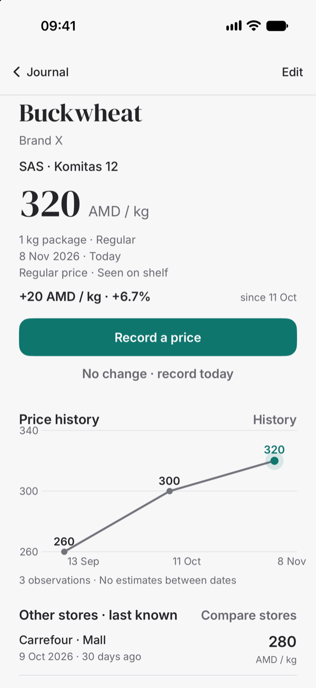
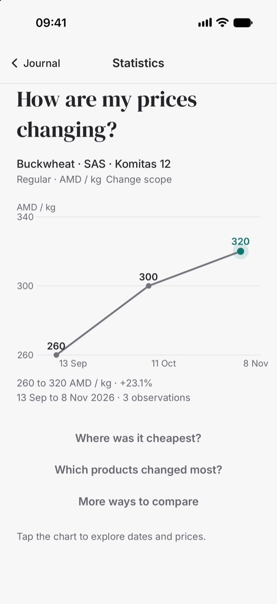
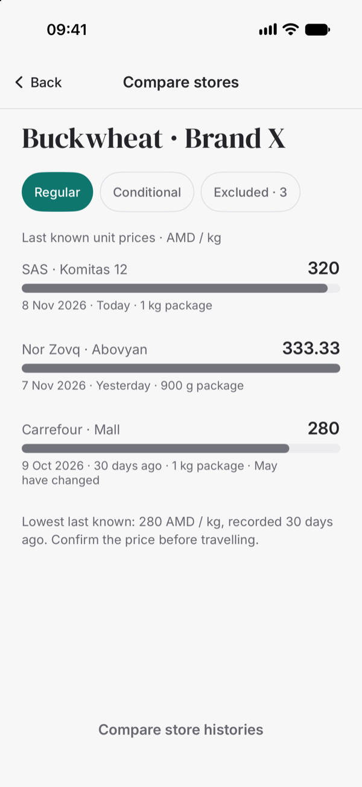
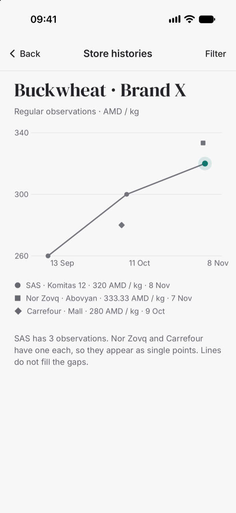
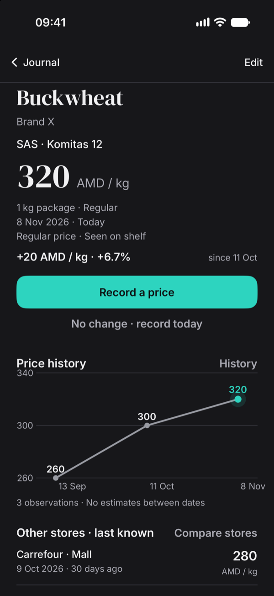
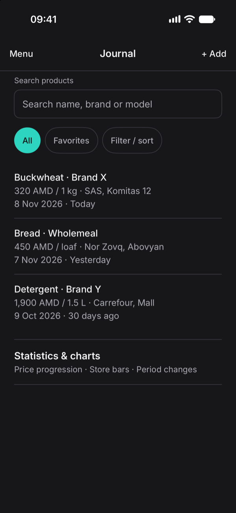

# Pricemori

**A private price journal for the shops you actually use.**

Pricemori remembers what things cost at your regular stores. Record a shelf price or what you paid, build a real history, and see how an offer compares with your own observations — before the next purchase.

No account. No cloud. No scraping. Everything stays on your iPhone.

<p align="center">
  
  
  
</p>

## Why it exists

Most price apps want a catalog, a login, or a connection. A price book should be simpler: the prices you saw, the branch where you saw them, and an honest comparison against your own earlier entries.

Pricemori is deliberately manual. You decide what is worth tracking. A purchase is not required — a shelf label is enough.

## What it does

### Record in seconds

- Keep the selected product and branch, default to today, and suggest the previous package size.
- **No change** creates today’s observation in one tap, with Undo.
- Add a card or multi-buy condition when the shelf price depends on eligibility or quantity.
- Backdate an earlier observation without replacing the latest price.

### Compare honestly

- Same product, same store, same currency, same conditions — otherwise no like-for-like change is invented.
- Normalize weight, volume, and item prices (`900 g for 300 AMD` becomes `333.33 AMD / kg`).
- Show observation dates and ages instead of pretending an old price is today’s offer.
- Keep card, multi-buy, unknown-size, and different-currency prices out of regular rankings.
- Distinguish a product’s all-time minimum from another store’s last known price.

### See the history

- A compact price chart on every product, with the latest observation highlighted.
- Full observation list, point details, corrections, deletion with Undo, and earlier entries.
- Price over time, store comparisons, branch histories, period changes, and package-versus-unit charts.
- Lines connect recorded points only. No daily estimates, forecasts, or made-up values.

### Keep the data yours

- Products, branches, observations, package sizes, conditions, and notes.
- Favorites, search, archive, and restore.
- Full JSON backup, spreadsheet-ready CSV export, validated merge, and safe replacement that requires a safety copy first.

<p align="center">
  
  
  
</p>

<p align="center">
  
  
</p>

## Privacy

Pricemori has no accounts, analytics, advertising, or network requests. There is no server and no shared price database.

Your journal is stored locally with SwiftData. Backups and CSV files leave the app only when you explicitly export them. Replacing the journal is blocked until a safety backup has been exported.

## Built with

- **SwiftUI** for the interface and the editorial design system.
- **SwiftData** for products, store locations, and observations.
- **Swift Charts** for price history and comparisons.
- **Decimal** arithmetic for money and unit prices.
- **DM Serif Display** and **Inter** bundled under the SIL Open Font License.

Minimum deployment target: **iOS 18**.

## Run it

1. Open `pricemori.xcodeproj` in Xcode.
2. Select the `pricemori` scheme and an iPhone simulator.
3. Build and run.

To load the demo journal in a Debug build, add the launch argument:

```text
-seed-sample
```

The app otherwise starts with an empty journal and the first-run flow.

## Test it

```bash
xcodebuild test \
  -project pricemori.xcodeproj \
  -scheme pricemori \
  -destination 'platform=iOS Simulator,name=iPhone 17'
```

The suite covers:

- percentage and money comparisons,
- unit normalization and package shrinkage,
- store, currency, condition, and dimension separation,
- backdated entries and stale observations,
- multi-buy pricing,
- currency rounding,
- backup round-trip, merge conflicts, replacement, and version validation,
- CSV export,
- first-price and repeat-entry flows, Undo, earlier observations, deletion, archiving, and store creation.

## Project structure

```text
pricemori/
  App/            App entry, router, root navigation
  Design/         Colors, typography, shared controls
  Models/         SwiftData models, drafts, presentation helpers
  Domain/         Price calculations, formatting, sample data
  Data/           Backup, CSV, restore, file documents
  Features/       Journal, product, recording, history, statistics,
                  stores, settings, archives
  Resources/      Bundled fonts and licenses
```

## Status

The first version is feature-complete for its offline, manual scope:

- first price, changed price, no-change repeat, correction, deletion, and Undo;
- product, store, and observation history;
- unit-aware comparisons and conditional offers;
- charts, statistics, filters, and period changes;
- archives, entry defaults, full backup, CSV export, merge, and safe replacement;
- light and dark appearances, Dynamic Type, and 44-point targets.

Not in this version: OCR, barcode catalogs, cloud sync, automatic promotions, budgets, and inflation forecasting.

## Design

Pricemori uses an open, editorial layout: a neutral background, serif headings for prices and products, Inter for controls and data, and one teal accent for the latest observation and primary actions. Color never replaces the signed number when a price goes up or down.

---

Built by [Andrew Maier](https://github.com/Dronnn).
